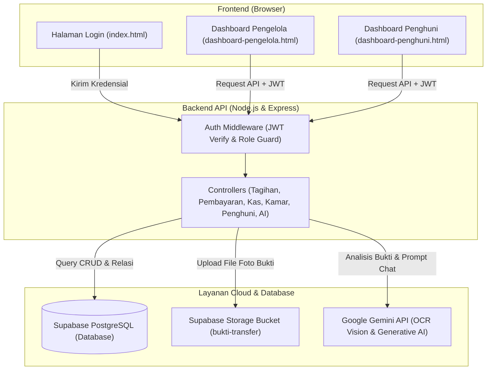
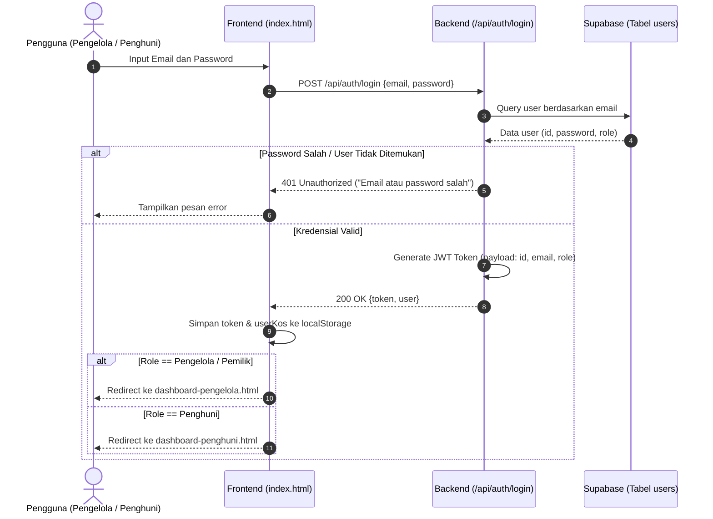
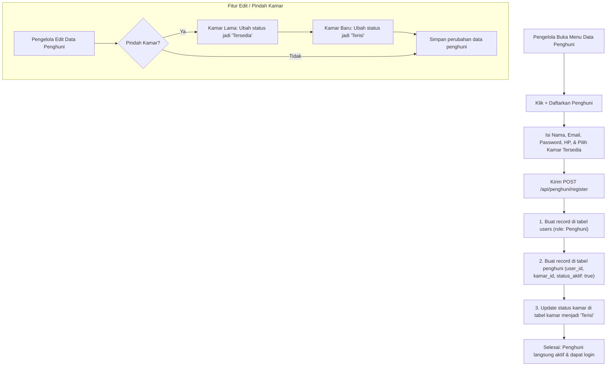
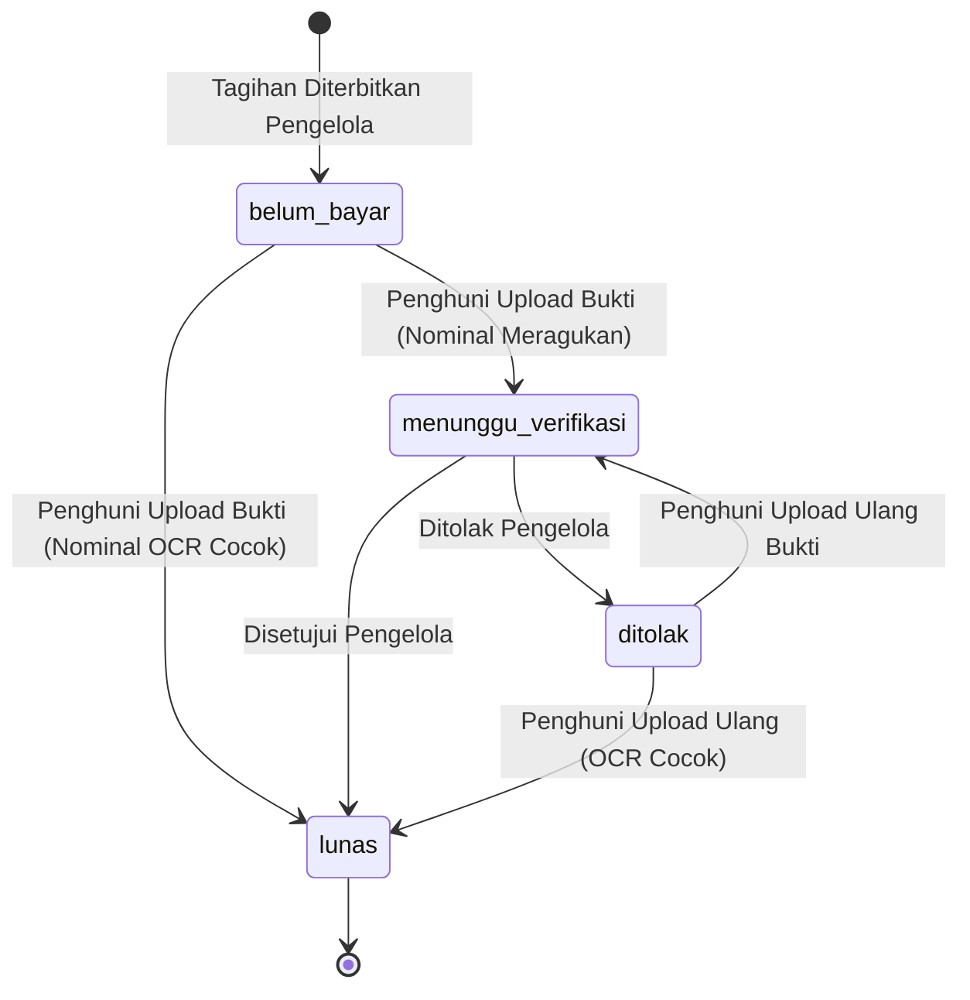
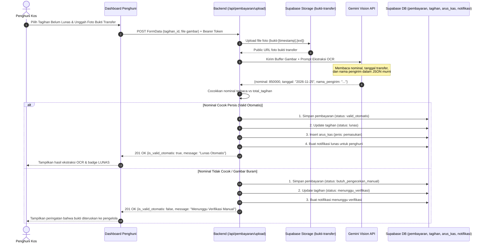
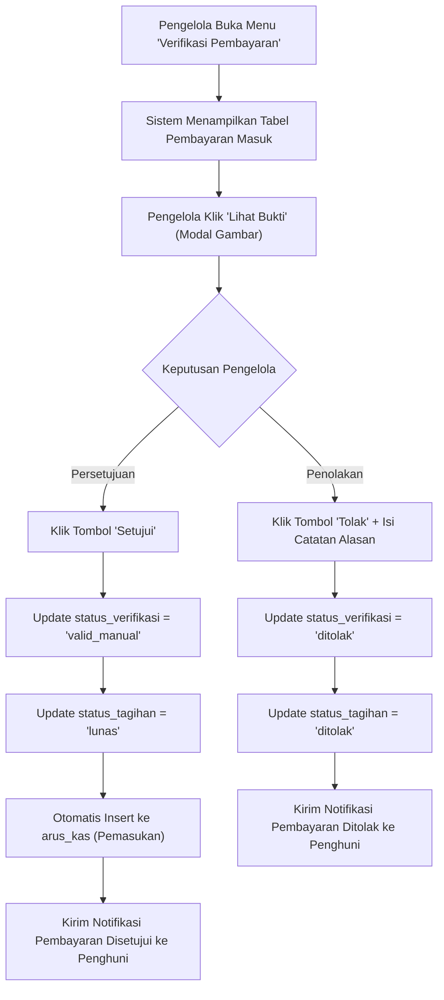
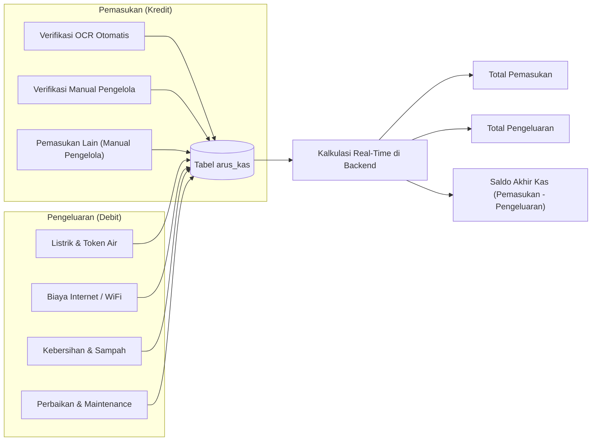
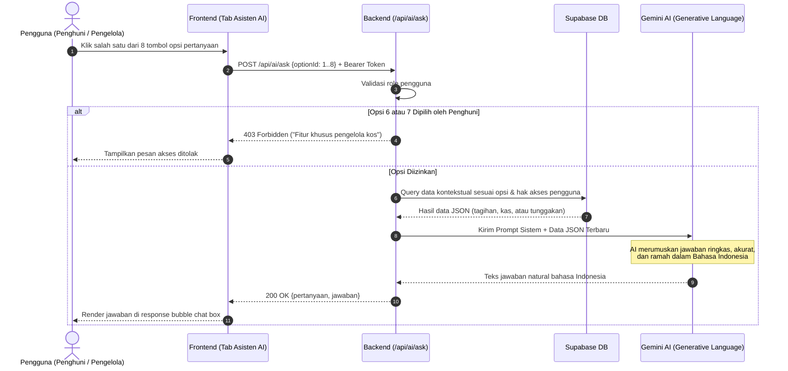

# Alur Kerja Sistem Informasi KasKos
### Sistem Informasi Pengelolaan Kas dan Tagihan Kos Terintegrasi Asisten AI dan Verifikasi OCR

Dokumen ini menjelaskan alur kerja (*business process flow*), arsitektur alur data, interaksi antar komponen, dan siklus hidup data pada aplikasi **KasKos**.

---

## 📑 Daftar Isi
1. [Gambaran Umum Arsitektur](#1-gambaran-umum-arsitektur)
2. [Matriks Peran dan Hak Akses](#2-matriks-peran-dan-hak-akses)
3. [Alur Otentikasi dan Keamanan Akun](#3-alur-otentikasi-dan-keamanan-akun)
4. [Alur Manajemen Kamar dan Penghuni](#4-alur-manajemen-kamar-dan-penghuni)
5. [Alur Siklus Tagihan dan Pengingat Jatuh Tempo](#5-alur-siklus-tagihan-dan-pengingat-jatuh-tempo)
6. [Alur Verifikasi Pembayaran OCR Cerdas (Core Flow)](#6-alur-verifikasi-pembayaran-ocr-cerdas-core-flow)
7. [Alur Verifikasi Manual oleh Pengelola](#7-alur-verifikasi-manual-oleh-pengelola)
8. [Alur Laporan Arus Kas Operasional](#8-alur-laporan-arus-kas-operasional)
9. [Alur Asisten Virtual Berbasis AI (8 Opsi)](#9-alur-asisten-virtual-berbasis-ai-8-opsi)

---

## 1. Gambaran Umum Arsitektur

Aplikasi KasKos dibangun menggunakan arsitektur **Client-Server RESTful**:

---

## 2. Matriks Peran dan Hak Akses

Sistem membedakan dua hak akses (*role*) utama:

| Modul / Fitur | Pengelola / Pemilik Kos | Penghuni Kos |
| :--- | :---: | :---: |
| **Login ke Sistem** | Ya | Ya |
| **Pendaftaran Akun Baru** | Mendaftarkan Penghuni Baru | Tidak (Dibuatkan oleh Pengelola) |
| **Dashboard Utama** | Saldo Kas, Total Penunggak, Status Kamar | Ringkasan Tagihan, Batas Tempo, Status Kamar |
| **Manajemen Kamar (CRUD)** | Penuh (Tambah, Edit, Hapus) | Tidak Ada |
| **Manajemen Penghuni** | Penuh (Pindah Kamar, Edit, Nonaktifkan) | Edit Profil Mandiri (Nama, HP, Password) |
| **Penerbitan & Edit Tagihan** | Penuh (Buat, Edit, Hapus) | Tidak Ada |
| **Melihat Tagihan** | Seluruh Tagihan Semua Penghuni | Hanya Tagihan Milik Sendiri |
| **Upload Bukti Bayar (OCR)** | Tidak (Hanya Meninjau) | Ya (Untuk Tagihan Milik Sendiri) |
| **Verifikasi Manual Pembayaran** | Ya (Setujui / Tolak Bukti) | Tidak Ada |
| **Laporan Arus Kas (CRUD)** | Penuh (Catat, Edit, Hapus Pemasukan/Pengeluaran) | Tidak Ada |
| **Asisten AI (Opsi 1-5, 8)** | Ya (Data Global) | Ya (Data Pribadi) |
| **Asisten AI (Opsi 6 & 7)** | Ya (Kas & Daftar Penunggak) | Ditolak (403 Forbidden) |

---

## 3. Alur Otentikasi dan Keamanan Akun

Untuk mencegah pembuatan akun ilegal oleh pihak luar, registrasi publik dinonaktifkan.

---

## 4. Alur Manajemen Kamar dan Penghuni

Pendaftaran penghuni langsung mengaitkan akun dengan kamar yang berstatus **Tersedia**:

---

## 5. Alur Siklus Tagihan dan Pengingat Jatuh Tempo

### Mekanisme Pengingat Jatuh Tempo Otomatis:
Setiap kali penghuni membuka dashboard, sistem menghitung selisih hari antara hari ini dan `tanggal_jatuh_tempo`:
- **Terlambat (`diffDays < 0`)**: Muncul banner merah tanda keterlambatan pembayaran dan denda.
- **Hari H (`diffDays == 0`)**: Muncul peringatan bahwa hari ini adalah batas akhir pembayaran.
- **Mendekati Tempo (`0 < diffDays <= 3`)**: Muncul banner kuning pengingat batas pembayaran.

---

## 6. Alur Verifikasi Pembayaran OCR Cerdas (Core Flow)

Alur verifikasi bukti transfer otomatis menggunakan Google Gemini Vision:

---

## 7. Alur Verifikasi Manual oleh Pengelola

Untuk pembayaran yang statusnya `butuh_pengecekan_manual` atau `menunggu_verifikasi`:

---

## 8. Alur Laporan Arus Kas Operasional

Sistem arus kas memastikan transparansi keuangan kos:

---

## 9. Alur Asisten Virtual Berbasis AI (8 Opsi)

Sesuai ruang lingkup, pengguna tidak mengetik bebas, melainkan memilih salah satu dari 8 opsi yang telah diprogram:

### Rincian Data Kontekstual per Opsi:
1. **Opsi 1 (Cek tagihan bulan ini dan depan)**: Mengambil data tagihan periode berjalan dan bulan berikutnya.
2. **Opsi 2 (Cek tanggal jatuh tempo)**: Memfilter tagihan yang berstatus belum lunas beserta tanggal jatuh tempo.
3. **Opsi 3 (Cek status pembayaran)**: Mengambil seluruh status tagihan (`lunas`, `menunggu_verifikasi`, `belum_bayar`).
4. **Opsi 4 (Riwayat pembayaran)**: Mengambil log pembayaran terdahulu dari tabel `pembayaran`.
5. **Opsi 5 (Cara upload bukti transfer)**: Memberikan panduan langkah demi langkah penggunaan fitur OCR.
6. **Opsi 6 (Rangkuman kas bulanan)**: *(Khusus Pengelola)* Mengambil total saldo, pemasukan, pengeluaran, dan 10 transaksi kas terakhir.
7. **Opsi 7 (Daftar penghuni yang menunggak)**: *(Khusus Pengelola)* Mengambil daftar nama penghuni, nomor kamar, nominal, dan batas tempo tagihan yang belum lunas.
8. **Opsi 8 (Cara menggunakan fitur lainnya)**: Memberikan panduan penggunaan menu-menu dashboard sesuai role masing-masing.
